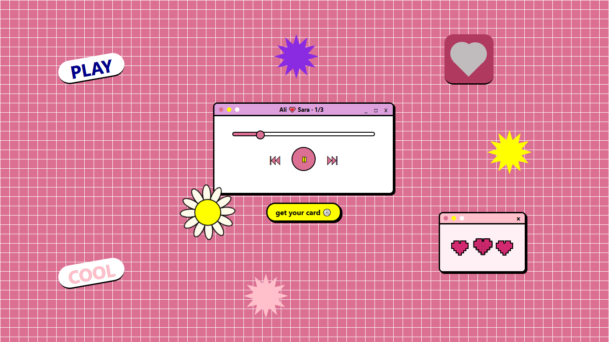
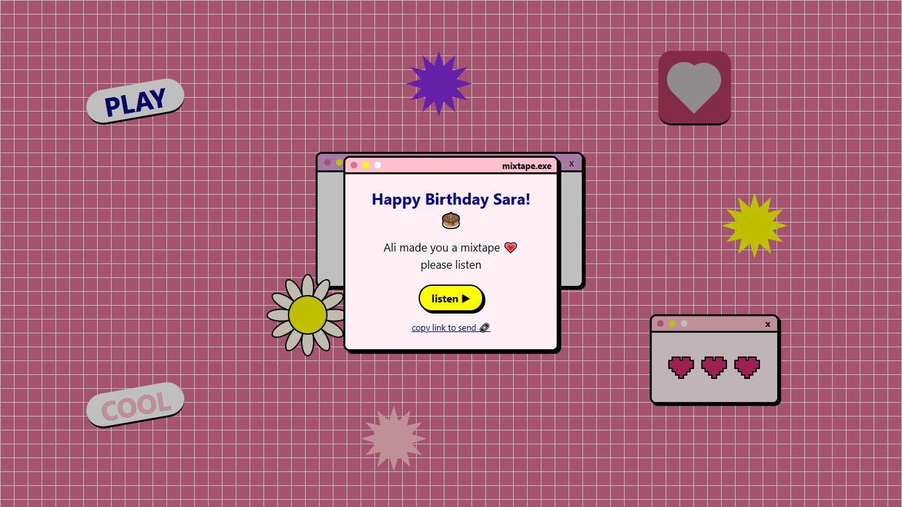
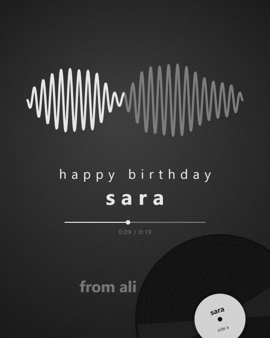
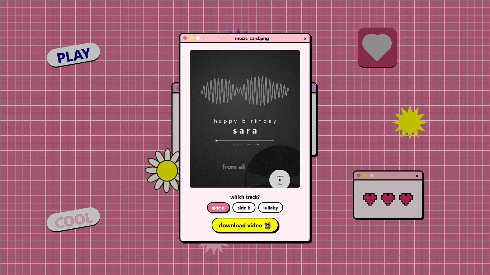

# 💗 friendship-mixtape

> A cute, doodle-style birthday mixtape made with plain **HTML + CSS + JS**. Type your name and your friend's name, and the page composes a little song from both names. 🎀

### 🌐 Try it live → [friendship-mixtape.vercel.app](https://friendship-mixtape.vercel.app)



<p align="center"></p>

---

## ✨ What's inside

| Sticker | What it is |
|---|---|
| 🩷 **Pink grid** | Background made of tiny white vertical + horizontal line divs |
| 💬 **PLAY / COOL bubbles** | Tilted speech-bubble stickers with bold text |
| ⭐ **Starbursts** | 12-point stars cut out with `clip-path: polygon()` |
| 🎵 **Mixtape player** | Window with a title bar, colored dots, `_ □ x` controls |
| 🎚️ **Progress slider** | A real, draggable `<input type="range">` that follows the song |
| ⏮ ▶ ⏭ **Buttons** | Play / pause and three tracks to skip between |
| 🌼 **Daisy flower** | 12 petals placed with `rotate()` + `translateY()`, spins while music plays |
| 💌 **Heart bubble** | A heart made from two circles and a rotated square |
| 👾 **Pixel hearts** | Pixel art drawn with one tiny box and 27 `box-shadow` copies, bouncing on every note |
| 🎂 **Birthday card** | Asks for both names, then shows a Happy Birthday message |
| 💿 **Video music card** | A black & white card with a sound wave and a vinyl that plays the song and downloads as a video |

## 🎹 How the music works

There are no mp3 files. Every sound is made live by the browser's **Web Audio API**:

1. Each letter of a name becomes a number (`a` = 97...), and that number picks a note from a **pentatonic scale** (C D E G A), so every name sounds sweet.
2. **Your name** plays a soft music-box melody (`triangle` + `sine` waves) and **your friend's name** plays a gentle low line.
3. Underneath, soft chords go **C → G → Am → F** (like lots of pop songs), with a deep bass and a little **reverb** so it sounds like a room.
4. 🎤 A **synthesized voice** sings along! It's made from a buzzing `sawtooth` wave shaped by three filters (*formants*, the way your mouth shapes "aa", "ee", "oo"), plus a little vibrato. It sings the vowels of a name: "Ayesha" → "aa… ee… aa…". In the lullaby it just hums "oooh".
5. Spaces become little rests. The shorter name loops so both layers play together.
6. Same names = the same song every time. It's *your* friendship's song 💗

## 🔗 Send it to a friend

After you make a mixtape, the link holds both names, like
[`friendship-mixtape.vercel.app/?from=Ali&to=Sara`](https://friendship-mixtape.vercel.app/?from=Ali&to=Sara)
Press **copy link to send**, share it, and your friend lands straight on their birthday message. 🎁

## 🎬 Video music card

Press **get your card 💿** under the player:

<p align="center">
  
  &nbsp;
  
</p>

- **Tap the card** to play its song right there. The black & white sound wave turns white as the song plays, and the vinyl spins.
- Pick **which track** to use: side a, side b or the lullaby.
- **download video 🎬** records the card with its song (about 20 seconds) and saves it as an `.mp4` (or `.webm` on some browsers).
- It's sized 1080×1350, ready for WhatsApp, Instagram or a story. Your friend taps it and hears their song. 💗
- Keep the tab open while it records!

## 🚧 Coming soon

- [x] `_ □ x` window buttons that actually work (minimize, maximize, close), and the mini window closes too
- [x] Looks nice on phones too (responsive)
- [ ] Star outlines

## 🎀 How to run

Easiest: open **[friendship-mixtape.vercel.app](https://friendship-mixtape.vercel.app)** 🌐

Or run it on your computer. No installs, no build:

1. Download / clone this folder
2. Double-click **`index.html`**
3. Enjoy the mixtape 💿

## 📁 Files

```
friendship-mixtape/
├── index.html   → the page structure
├── style.css    → all the cute styling
├── script.js    → names, music and buttons
├── favicon.svg  → the little pink cassette icon in the tab
├── screenshots/ → pictures for this README
└── doodle.PNG   → the design reference I started from
```

## 🧠 Things I learned while making this

- `position: absolute` + `position: relative` to layer stickers on top of the grid
- `overflow: hidden` can hide things you *didn't* mean to hide 👀
- `clip-path` to cut shapes like stars
- One `transform` line can hold both `translate()` and `rotate()`
- Child styles win over parent styles (hello, `font-size` bug!)
- Styling a range slider with `::-webkit-slider-thumb` and `::-moz-range-thumb`
- Pixel art with many `box-shadow`s, and an outline that follows the shape with `filter: drop-shadow()`
- Making music with an oscillator, and scheduling notes on the audio clock
- Drawing on a `<canvas>` and recording it with sound using `MediaRecorder`

---

<!-- taggie -->
Made with ❤ for friendship
<!-- /taggie -->
